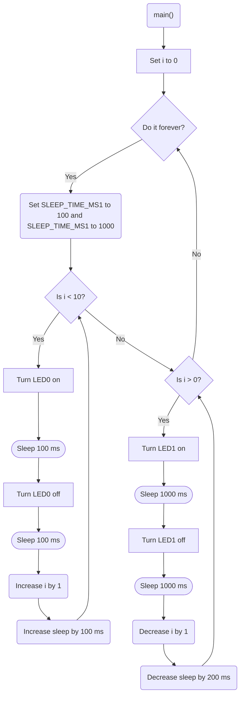

# Program: Two Hearts
**Author(s):** Mitchell Endicott
**Date:** 1/5/26

**Modified by:** Mitchell Endicott
**Date:** 1/5/26

**Purpose:** This program flashes two of the internal LEDs on the nRF52840 DK. One flashes ten times, speeding up each time, and then the other flashes 5 times, slowing down each time. The cycle repeats forever.

## Configuration
Uses default devicetree configuration

## Hardware
### Internal
* LED1 (digital output)
* LED2 (digital output)

## Flow

`Completed:` 1/5/26 2:21pm