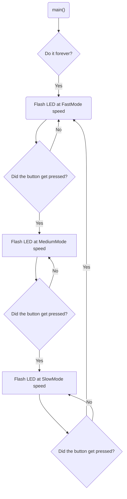

# Program: Three Rates, One Heart
**Author(s):** Mitchell Endicott <mendicott29@my.whitworth.edu>
**Date:** January 6, 2026

**Modified by:** Mitchell Endicott <mendicott29@my.whitworth.edu>
**Date:** January 6, 2026

**Purpose:** This program flashes an internal LED on the nRF52840 DK at a rate selected using an internal button. The three rates are:

* Fast (period of 200 ms)
* Medium (period of 400 ms)
* Slow (period of 1000 ms)

The on or off time is equal to half the period.

## Configuration
Uses default devicetree configuration

## Hardware
### Internal
* LED1 (digital output)
* BUTTON1 (digital input)

## Flow

`Completed:` 1/6/26 6:28pm