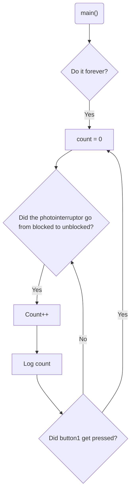

# Program: Letter counter
**Author(s):** Mitchell Endicott
**Date:** 1/20/26

**Modified by:** Mitchell Endicott
**Date:** 1/20/26

**Purpose:** This application counts letters as they pass through a photointerrupter. The current count is displayed using Zephyr's logger module. The count can be reset to zero using an internal button.

## Configuration

Devicetree overlay:

* P0.03 is a digital input (button-like behavior)

Kernel configuration via `prj.conf`:

* Logger enabled

## Hardware
### External
Photointerrupter (Isocom H21A1) with the following connections:

* pin 1 to 330 ohm resistor which is connected to
  * VDD (+3 V)
  * 10k ohm resistor to P0.03
* pin 2 to GND
* pin 3 to P0.03
* pin 4 to GND

### Internal
* BUTTON1 (digital input)

## Flow

`Completed:` 1/20/26 10:45am