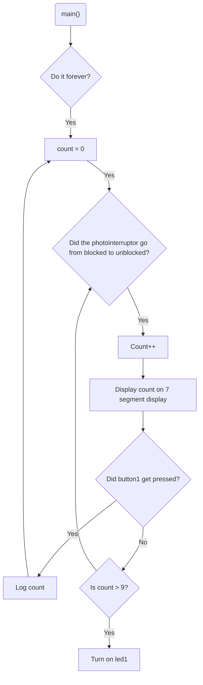

# Program: Letter counter
**Author(s):**  Mitchell Endicott
**Date:** 1/12/26

**Modified by:**  Mitchell Endicott
**Date:** 1/12/26

**Purpose:** This application counts letters as they pass through a photointerrupter. The current count is displayed on a seven segment display with an internal LED used to indicate that the true count is 10 plus whatever is displayed on the seven-segment display. The count can be reset to zero using an internal button. This also sends a log message with the count when the button is pressed.

## Configuration

Devicetree overlay:

* P0.03 is a digital input (button-like behavior)

Kernel configuration via `prj.conf`:

* Logger enabled

## Hardware
### External
Photointerrupter (Isocom H21A1) with the following connections:

* pin 1 to 330 ohm resistor which is connected to
  * VDD (+3 V)
  * 10k ohm resistor to P0.03
* pin 2 to GND
* pin 3 to P0.03
* pin 4 to GND

Seven-segment display (LIGITEK LSD3211) with the following connections:
* gnd (on 7-segment display) to GND (on microcontroller via bus strip)
* P1.01 through P1.07 connected to _a_ through _g_ pins on 7-segment display

### Internal
* BUTTON1 (digital input)
* LED1 (digital output)

## Flow

`Completed:` 1/12/26 11:09am
