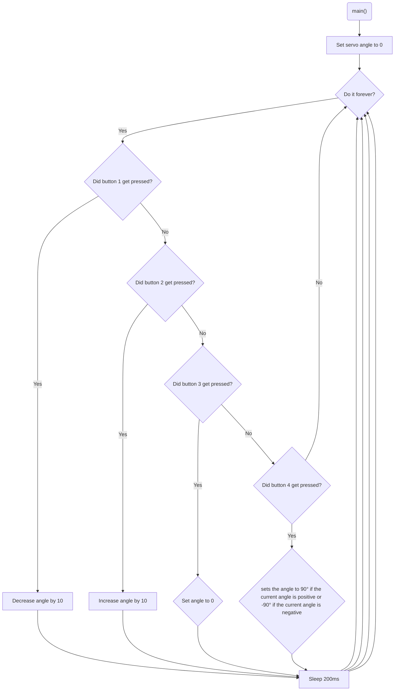

# Program: Servo controller
**Author(s):** Mitchell Endicott
**Date:** 1/12/26

**Modified by:** Mitchell Endicott
**Date:** 1/12/26

**Purpose:** This application moves the servo to a location selected by button presses.

* BUTTON 1: decreases the current angle by 10&deg;
* BUTTON 2: increases the current angle by 10&deg;
* BUTTON 3: sets the angle to 0&deg;
* BUTTON 4: sets the angle to 90&deg; if the current angle is positive or -90&deg; if the current angle is negative

## Configuration

### Devicetree overlay

* P0.03 is PWM signal for servo control

### Kernel configuration via `prj.conf`

* Logging 
* Pulse-width modulation

## Hardware
### External
Servo (Hitec HS-422) with the following connections:

* black lead to GND
* red lead to +6 V (from battery pack)
* yellow lead to P0.03

### Internal
* BUTTON1 (digital input)
* BUTTON2 (digital input)
* BUTTON3 (digital input)
* BUTTON4 (digital input)

## Flow

`Completed:` 1/12/26 10:46am