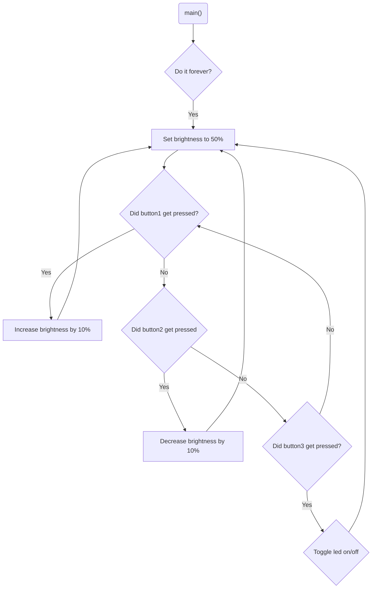

# Program: Dimmer control
**Author(s):** Mitchell Endicott
**Date:** 1/20/26

**Modified by:** Mitchell Endicott
**Date:** 1/20/26

**Purpose:** This application adjusts the brightness of an external LED. The LED should have brightness levels ranging from 0% (off) to 100% (maximum brightness), adjustable in increments of 10%.

* BUTTON 1: increases the duty cycle by 10%
* BUTTON 2: decreases the duty cycle by 10%
* BUTTON 3: toggles the light off or on. The brightness setting should be remembered when it is toggled off so that when toggled on again the previous brightness setting is restored.

Each button press and release should trigger the corresponding action just once.

## Configuration

### Devicetree overlay

* P0.28 is the PWM signal for the LED

### Kernel configuration via `prj.conf`

* Logging 
* Pulse-width modulation

## Hardware
### External
External LED with the following connections:

* Short leg to GND
* Long Leg to 330 ohm resister to P0.03
* GND to GND

### Internal
* BUTTON1 (digital input)
* BUTTON2 (digital input)
* BUTTON3 (digital input)

## Flow

`Completed:` 1/20/26 11:30am