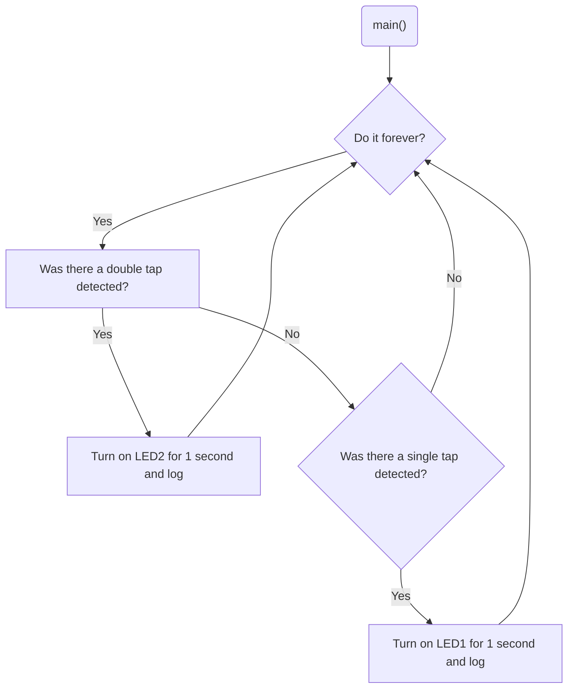

# Program: Tap detector
**Author:** Mitchell Endicott
**Date:** 1/20/26

**Modified by:**  Mitchell Endicott
**Date:** 1/20/26

**Purpose:** This application uses an ADXL345 accelerometer to detect single and double tap events using SPI communication. The accelerometer is configured to assert its INT2 pin when a tap event occurs. Inside the main loop, the program monitors the interrupt pin and reads the accelerometer interrupt source register to determine whether a single or double tap was detected. If a single tap (and not part of a double tap) is detected, LED1 is turned on for one second. If a double tap is detected, LED2 is turned on for one second.
## Configuration

### Devicetree overlay

* SPI1 enabled for communication with the ADXL345 accelerometer
* ADXL345 configured as an SPI device with chip select on P0.30
* Accelerometer interrupt (INT2) connected to P0.04

### Kernel configuration via `prj.conf`

* Logging
* SPI

## Hardware
### Internal

* LED1 (digital output – single tap indicator)
* LED2 (digital output – double tap indicator)

### External

ADXL345 accelerometer with these connections:
    * CS → P0.30
    * SCL → P0.28
    * SDA → P0.29
    * SDO → P0.31
    * INT2 → P0.04

## Flow

`Completed:` 1/20/26 7:40pm