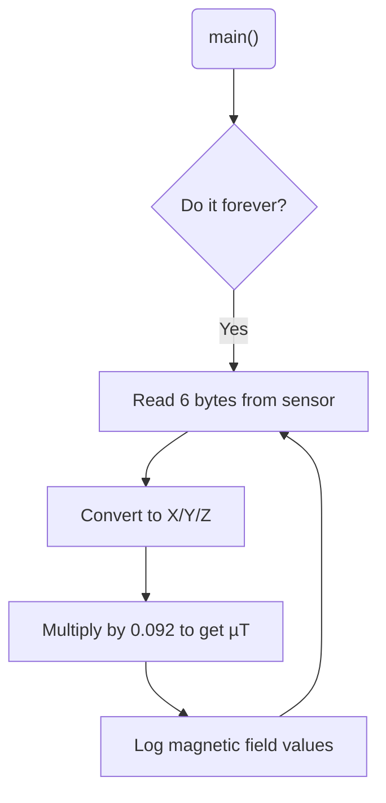

# Program: Digital Compass
**Author(s):** Mitchell Endicott 
**Date:** 1/22/26

**Modified by:** Mitchell Endicott
**Date:** 1/22/26

**Purpose:** This program reads magnetic field data from an HMC5883L digital compass over I²C and prints the X, Y, and Z components. It continuously updates the readings so you can see how the field changes in real time.

## Configuration

Devicetree overlay:

* I2C0 enabled

Kernel configuration via `prj.conf`:

* I2C
* Log
* Printf fp support

## Hardware
### External

* HMC5883L digital compass with these connections:

    * SDA → P0.26 with 4.7 kΩ pull-up to 3.3 V
    * SCL → P0.27 with 4.7 kΩ pull-up to 3.3 V

### Internal

* None 

## Flow

`Completed:` 1/23/26 11:27am