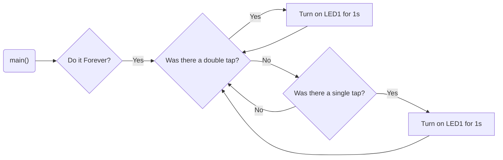

# Program: Tap Detector
**Author(s):** Mitchell Endicott
**Date:** 1/22/26

**Modified by:** Mitchell Endicott
**Date:** 1/22/26

**Purpose:** This application waits for single and double taps on an ADXL345 accelerometer. A single tap lights LED1, a double tap lights LED2

## Configuration

Devicetree overlay:

* I2C0 enabled for communication with the ADXL345
* ADXL345 configured as an I2C device at address 0x53
* Accelerometer INT2 connected to P0.02

Kernel configuration via `prj.conf`:

* I2C
* Log

## Hardware
### External

* ADXL345 accelerometer with these connections:
    * CS → VDD
    * INT2 → P0.02
    * SDO → GND
    * SDA → P0.26
    * SCL → P0.27
    
### Internal

* LED0
* LED1

## Flow

`Completed:` 1/22/26 4:35pm
