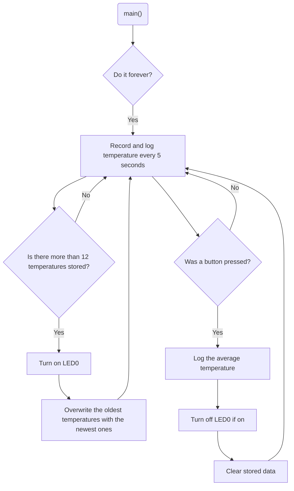

# Program: Analog temperature logger
**Author(s):** Mitchell Endicott
**Date:** 1/21/26

**Modified by:** Mitchell Endicott
**Date:** 1/21/26

**Purpose:** This application uses a TMP36 analog temperature sensor to record temperature once every five seconds. Temperature samples are stored in an array with a maximum capacity of twelve readings. When the buffer becomes full, an LED is turned on to indicate that the maximum number of samples has been reached. If additional samples are collected, the oldest values are overwritten so that only the twelve most recent measurements are kept. When a button is pressed, all stored temperature values and their average are logged, the buffer is cleared, and the LED is turned off.

## Configuration

Devicetree overlay:

* ADC enabled for analog temperature measurement
* SAADC channel configured for TMP36 input (AIN1)
* TMP36 defined as an analog temperature sensor device

Kernel configuration via `prj.conf`:

* Logging
* ADC

## Hardware
### External

* TMP36 temperature sensor

### Internal

* Button (digital input)
* LED0 (digital output – buffer full indicator)

## Flow

`Completed:` 1/21/26 8:42pm