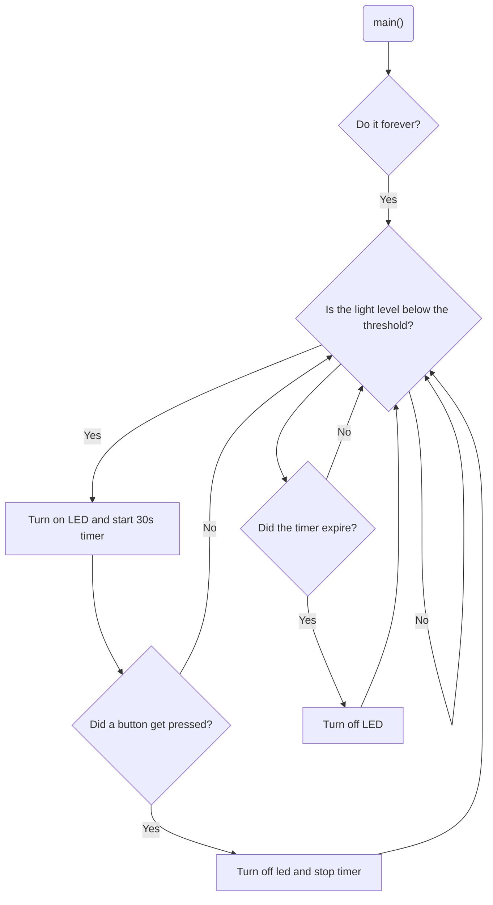

# Program: Night Light
**Author(s):** Mitchell Endicott
**Date:** 1/23/26

**Modified by:** Mitchell Endicott
**Date:** 1/23/26

**Purpose:** This application monitors ambient light using an LDR. When light drops below normal room levels, the internal LED turns on for 30 seconds. An external push button can turn off the LED sooner.

## Configuration

Devicetree overlay:

* External button sw0 connected to P0.03
* LDR ADC channel configured on ADC channel 0

Kernel configuration via `prj.conf`:

* ADC
* GPIO
* LOG
* Float point support
* ADC NRFX SAADC

## Hardware
### External

* Push button connected to P0.03
* LDR sensor wired to p0.02

### Internal

*LED0

## Flow

`Completed:` 1/23/26 1:54am
