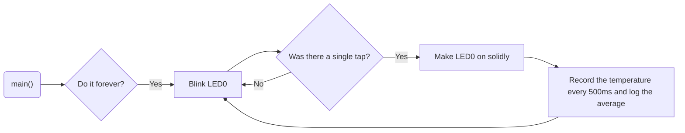

# Program: Tap Temperature Logger
**Author(s):** Mitchell Endicott
**Date:** 1/21/26

**Modified by:** Mitchell Endicott
**Date:** 1/21/26

**Purpose:** This application waits for a single-tap interrupt from an external accelerometer while blinking an LED with a 1-second period. When a single tap is detected, the LED is held on and twenty temperature samples are collected from an analog TMP36 temperature sensor at 500 ms intervals. After all samples are collected, the average temperature is calculated and logged to the console. The system then returns to waiting for the next tap and resumes LED blinking.

## Configuration

Devicetree overlay:

* SPI1 enabled for communication with the ADXL345 accelerometer
* Accelerometer connected via SPI with chip select on P0.30
* Accelerometer interrupt (INT2) connected to P0.04
* ADC enabled for TMP36 temperature sensor input
* TMP36 configured as an analog temperature sensor using SAADC

Kernel configuration via `prj.conf`:

* Logging
* SPI
* GPIO
* ADC

## Hardware
### External
ADXL345 accelerometer with these connections:
    * CS → P0.30
    * SCL → P0.28
    * SDA → P0.29
    * SDO → P0.31
    * INT2 → P0.04
TMP36 connected to P0.04

### Internal
LED0 (digital output)
## Flow

`Completed:` 1/21/26 7:55pm