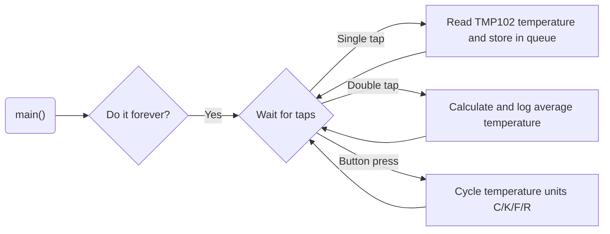

# Program: Tap Temperature Logger
**Author(s):** Mitchell Endicott
**Date:** 1/22/26

**Modified by:** Mitchell Endicott
**Date:** 1/22/26 

**Purpose:** This application waits for single and double taps from an ADXL345 accelerometer. On a single tap, it reads the TMP102 temperature and stores it in a queue (max 20 samples). On a double tap, it calculates and logs the average of the stored temperatures. A button cycles the displayed temperature units (C, K, F, R).

## Configuration

Devicetree overlay:

* SPI1 enabled for communication with the ADXL345
* ADXL345 configured as an SPI device with chip select on P0.30
* Accelerometer interrupt (INT2) connected to P0.04
* I2C enabled for comminication with TMP102

Kernel configuration via `prj.conf`:

* I2C
* LOG
* Float point support
* SPI

## Hardware
### External

* TMP102 with these connections:
    * SDA → P0.26
    * SCL → P0.27

* ADXL345 accelerometer with these connections:
    * CS → P0.30
    * SCL → P0.28
    * SDA → P0.29
    * SDO → P0.31
    * INT2 → P0.04

### Internal

* Internal button 

## Flow

`Completed:` 1/22/26 11:45pm